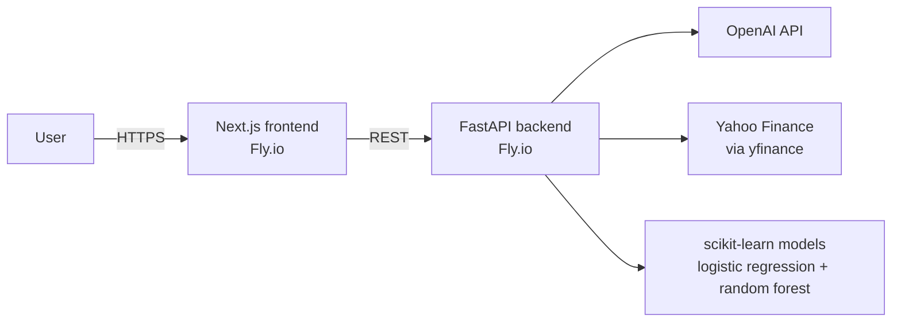

# Personal Portfolio

A full-stack portfolio site that hosts two working projects: an **LLM-powered earnings call summarizer** and a **machine learning price prediction model** for SPY.

**Live site:** https://ml-project-web.fly.dev

> The backend scales to zero when idle, so the first request after a quiet period can take a few seconds while it starts.

---

## Projects

### Earnings Call Summarizer

Paste or upload an earnings call transcript and get a bullet-point summary checked against market data.

1. An OpenAI model identifies the company's ticker and returns it as structured JSON.
2. The backend pulls growth estimates, insider purchases, and analyst price targets for that ticker from Yahoo Finance (via `yfinance`).
3. The model summarizes the call and calls out where management's commentary agrees or conflicts with that data.

### Price Prediction Model

Predicts SPY's direction and price over the next 10 trading days. Visitors can use the built-in SPY history or upload their own CSV of daily prices.

- **Direction model:** logistic regression that classifies up vs. down, with its decision threshold tuned on a held-out slice of the training data.
- **Return model:** random forest regressor that predicts the 10-day return, which is converted to a target price.
- **Features:** 5-day return, 20- and 60-day momentum, and distance from the 50-day moving average, all computed from data up to the prior close.
- **Labels:** days where the 10-day move is within ±0.5% are excluded from training as a no-trade band.
- **Evaluation:** chronological 80/20 train/test split, compared against naive baselines (always predict "up" for direction; predict no change for return and price).
- On the site, a prediction is marked **confirmed** when both models agree on direction.

---

## Architecture



| Layer | Stack |
|---|---|
| Frontend | Next.js 14, React, TypeScript, Tailwind CSS, Recharts |
| Backend | Python, FastAPI, pandas, scikit-learn, OpenAI API, yfinance |
| Hosting | Fly.io (Docker), separate apps for frontend and backend |

### API

| Method | Endpoint | Purpose |
|---|---|---|
| `GET` | `/` | Health check |
| `POST` | `/initanalyze/text` | Summarize a pasted transcript (`{"text": "..."}`) |
| `POST` | `/initanalyze/file` | Summarize an uploaded transcript file |
| `GET` | `/predict/default` | Recent SPY history plus the next 10 predictions |
| `POST` | `/predict/file` | Same, for an uploaded CSV with `Date` and `Close` (or `Adj Close`) columns |

---

## Repository Layout

```text
.
├── app/
│   ├── backend/
│   │   ├── ecfast.py         # FastAPI app deployed to production (both projects)
│   │   ├── ml.py             # Features, training, and prediction for the price model
│   │   ├── data/spy.csv      # SPY daily history for training and the default demo
│   │   ├── models/           # Saved model artifact
│   │   ├── app/              # Original health-check service (FastAPI + Postgres), not deployed
│   │   ├── Dockerfile
│   │   ├── fly.toml
│   │   └── requirements.txt
│   └── frontend/
│       ├── app/
│       │   ├── page.tsx                            # Home
│       │   ├── projects/page.tsx                   # Project list
│       │   ├── projects/earnings-summarizer/page.tsx
│       │   ├── projects/price-prediction/page.tsx
│       │   └── resume/page.tsx                     # Experience
│       ├── Dockerfile
│       └── fly.toml
├── pyproject.toml            # Local Python environment (uv)
└── uv.lock
```

---

## Running Locally

### Backend

```bash
cd app/backend
python -m venv .venv
source .venv/bin/activate
pip install -r requirements.txt
export OPENAI_API_KEY="your-key"
uvicorn ecfast:app --reload --port 8080
```

If no saved model exists, the price model trains on `data/spy.csv` the first time a prediction is requested.

### Frontend

```bash
cd app/frontend
npm install
NEXT_PUBLIC_API_URL=http://localhost:8080 npm run dev
```

Then open http://localhost:3000.

### Environment Variables

| Variable | Where | Notes |
|---|---|---|
| `OPENAI_API_KEY` | Backend | Required; the backend will not start without it |
| `OPENAI_MODEL` | Backend | Optional; defaults to `gpt-4.1-mini` |
| `CORS_ALLOWED_ORIGINS` | Backend | Optional comma-separated list; defaults to `localhost:3000` and the live site |
| `NEXT_PUBLIC_API_URL` | Frontend | Optional; defaults to the production API |

---

## Deployment

Each app deploys to Fly.io from its own directory:

```bash
cd app/backend && fly secrets set OPENAI_API_KEY="your-key" && fly deploy
cd app/frontend && fly deploy
```
